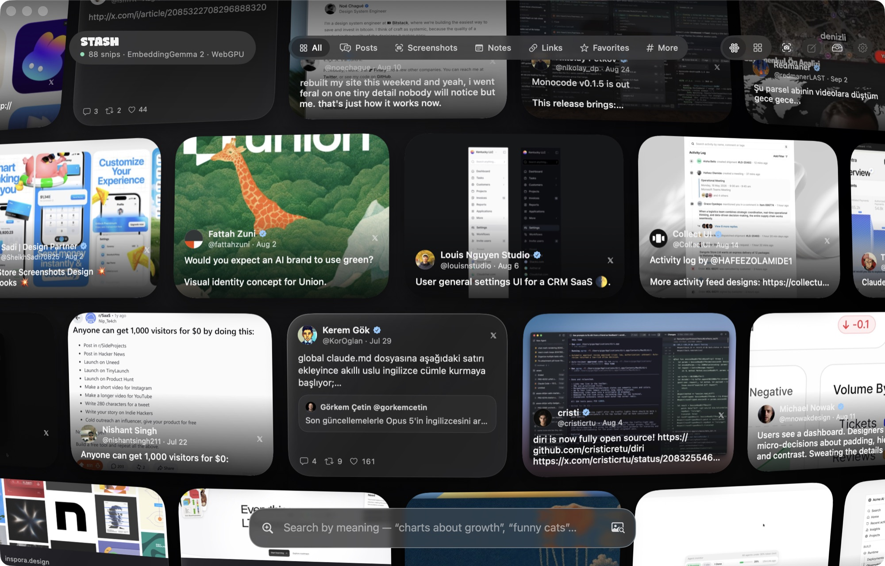
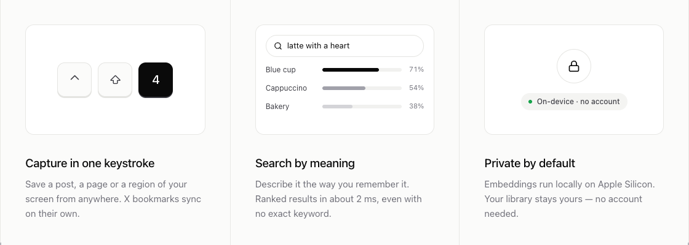

<p align="center">
  
</p>

<h1 align="center">Stash</h1>

<p align="center"><b>Save anything. Find it by meaning.</b></p>

<p align="center">
  Every post, page and screenshot you keep, in one library on your Mac.<br>
  Describe what you remember. Stash finds it.
</p>

<p align="center">
  <a href="https://github.com/mrtcmn/stash/releases/latest/download/Stash.dmg"><b>Download for Mac</b></a> ·
  <a href="https://stash.grasco.dev">Website</a> ·
  <a href="https://chromewebstore.google.com/detail/stash-%E2%80%94-save-to-mac/ekcefgmlhmapfkgbomdighgcedpfemlb">Chrome extension</a>
</p>

<p align="center">
  
  
  
  <a href="https://github.com/mrtcmn/stash/releases/latest"></a>
</p>

<p align="center">
  
</p>

## Why Stash?

Folders and tags take work. So most bookmarks never get a second look.

Stash reads each item as you save it. Later, you describe it the way you remember it. For example: *"chart showing revenue growth"*. Stash shows you the screenshot, even if those words are not in it.

<p align="center">
  
</p>

## What you get

### Save from anywhere

- **Posts from X.** A *Snip* button appears on every post in Chrome, Arc, Brave, Edge, Vivaldi and other Chromium browsers. Stash keeps long posts in full, with images, videos, quotes and link cards.
- **Your X bookmarks.** One click imports them all. Archives, CSV and JSON files import too.
- **Screenshots.** Capture an area, a window or the full screen. Or capture text, and Stash copies it with OCR.
- **Annotate.** Add arrows, boxes, text, numbered steps and a highlighter. Blur out private parts.
- **Quick notes.** Press ⌃⇧N for a note from any app.
- **Clipboard, color picker, drag and drop.** Stash takes those too.

### Find it again

- **Search by meaning.** Stash uses Google's EmbeddingGemma 2. Text and images live in one space, so words can find pictures.
- **Search by image.** Drop a picture on the search bar. Or pick *More like this* on any card.
- **Smart filters.** Try `from:handle`, `tag:name`, `type:screenshot`, `is:fav` or `"exact phrase"`.
- **Text inside screenshots.** Stash reads it and makes it searchable.

### Open it like new

<p align="center">
  
</p>

- Posts open as you saved them, with media, threads and replies.
- Use the arrow keys to move through your results.
- View your library as a globe or as a grid.

### Private by default

- Search runs on your Mac. Your snips are not uploaded.
- You do not need an account.
- The library lives in `~/Library/Application Support/Stash`.
- Stash uses the network to download the model once. It also fetches images and previews of the things you save.

## Get started

1. **Download** [Stash.dmg](https://github.com/mrtcmn/stash/releases/latest/download/Stash.dmg) and open it.
2. **Install the extension** from the [Chrome Web Store](https://chromewebstore.google.com/detail/stash-%E2%80%94-save-to-mac/ekcefgmlhmapfkgbomdighgcedpfemlb). Keep Stash running. The extension talks to it on your Mac.
3. **Save something.** Press ⌃⇧4 to capture an area. Or click *Snip* on a post.
4. **Search.** Press ⌃⇧Space and describe what you want.

You need a Mac with Apple Silicon and macOS 26 or later. Semantic search downloads a model of about 300 MB the first time. Without WebGPU, Stash uses Apple's built-in text embeddings instead.

### Shortcuts

| Action | Shortcut |
| --- | --- |
| Capture area | ⌃⇧4 |
| Capture window | ⌃⇧5 |
| Capture screen | ⌃⇧3 |
| Capture text (OCR) | ⌃⇧2 |
| Quick note | ⌃⇧N |
| Snip the browser tab | ⌃⇧X |
| Save clipboard | ⌃⇧V |
| Pick color | ⌃⇧C |
| Search library | ⌃⇧Space |

You can change all of them in Settings › Shortcuts. The extension adds **⌥⇧S** (save page or selection) and **⌥⇧A** (screenshot of the visible area).

### URL scheme

Use these from Raycast, Alfred or Shortcuts:

`stash://search?q=…` · `stash://capture/area|window|screen|text` · `stash://note?text=…` · `stash://save?url=…` · `stash://import-bookmarks`

## Build from source

```bash
make run              # builds build/Stash.app and opens it
# or
scripts/build-app.sh  # release build, ad-hoc signed
```

You need macOS 26 and Xcode 26 (or its command line tools, Swift 6.2).

macOS ties the Screen Recording permission to the code signature. An ad-hoc build asks again after each rebuild. Sign with your own certificate to avoid this:

```bash
SIGN_IDENTITY="Apple Development: Your Name (TEAMID)" scripts/build-app.sh
```

To use Xcode, run `brew install xcodegen && xcodegen`. This creates `Stash.xcodeproj` from `project.yml`.

To load the extension from source, open `chrome://extensions`, turn on **Developer mode**, click **Load unpacked** and choose the `Extension` folder.

<details>
<summary><b>How search works</b></summary>

```
snip ──► EmbeddingDocument ──► EmbeddingGemma 2 (WebGPU, in a hidden WKWebView) ──► 768-d vector ──► SQLite
query ─► "task: search result | query: …" ─► vector ─► cosine vs all snips ─┐
                                              keywords + filters ──────────┴─► hybrid ranking
```

- The model is [`onnx-community/embeddinggemma-2-ONNX`](https://huggingface.co/onnx-community/embeddinggemma-2-ONNX). It runs with [Transformers.js](https://huggingface.co/docs/transformers.js) in a hidden `WKWebView`.
- Screenshots are embedded as image plus recognized text. Post photos join the post text.
- Stash recomputes a vector only when the content of a snip changes.
- The local API listens on the loopback interface only. It needs the `X-Stash-Client` header, and websites cannot send that header.

</details>

<details>
<summary><b>Project layout and tests</b></summary>

```
Sources/StashCore   Model, SQLite storage, ranking, parsing (Foundation only)
Sources/Stash       The macOS app: SwiftUI + AppKit, ScreenCaptureKit, Vision, WebKit
Extension/            Chromium MV3 extension
Tests/                XCTest suite for StashCore
web/                  The website (stash.grasco.dev)
App/                  Info.plist, entitlements, icon
```

```bash
swift test                                  # StashCore
node --test "Extension/tests/*.test.mjs"    # the extension's X parser
```

</details>

## Contributing

Found a bug or have an idea? [Open an issue](https://github.com/mrtcmn/stash/issues). Pull requests are welcome. Please run the tests before you send one.

## License

Stash is open source under the [MIT License](LICENSE).

The app and extension icons use the [Lucide](https://lucide.dev) scissors glyph (ISC license).
